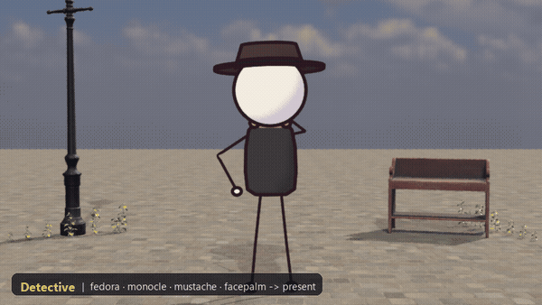

# Stickblend Starter Kit

<p align="center">
  
</p>

Create vertical **2.5D stickman story shorts** rendered in **Blender 5.2 EEVEE** (photorealistic CC0 3D worlds with flat 2.5D stickmen casting real shadows) and composited in **Remotion** (Gemini TTS voiceover, Whisper word timings, royalty-free music, CC0 SFX, captions, and SVG overlays).

### Character Customization & Animation
Mix and match hats (`tophat`, `fedora`, `bowler`, `beret`, `crown`, `pickelhaube`, `cap`, `beanie`), hair (`parted`, `ponytail`, `bun`, `afro`, `curly`, `spiky`, `mohawk`), outfits (`cape`, `apron`, `suspenders`, `tie`, `scarf`, `skirt`, `medals`, `epaulettes`), facial details (`mustache`, `beard`, `goatee`, `freckles`, `scar`, `eyelashes`, `glasses`, `monocle`), and procedural poses (`facepalm`, `present`, `clap`, `hips`, `wave`, `bow`, `whisper`, `crossed`, `kick`, `cheer`, `kneel`, `nervous`, `lean_back`, plus walk/run cycles and automatic blinking).

Re-render the showcase yourself with:
```powershell
blender -b --factory-startup -P stickblend/demo_showcase.py
```

## Prerequisites
- **Blender 5.2** (default Windows path: `C:\Program Files\Blender Foundation\Blender 5.2\blender.exe`)
- **Python 3.10+** (`pip install faster-whisper pillow numpy scipy`)
- **Node.js 18+** & **FFmpeg** on `PATH`
- **Gemini API Key** (free or paid) for TTS voiceover

## Quick Setup (~5 minutes)

1. Copy `.env.example` to `.env` and add your `GEMINI_API_KEY`.
2. Run the automated setup script (installs Remotion packages, downloads the reusable royalty-free music + CC0 SFX library, and downloads a starter pack of CC0 Poly Haven PBR textures, models, and pure-sky HDRIs):
   ```powershell
   .\setup.ps1
   ```
   *(Optional: download Quaternius "Ultimate Stylized Nature - May 2022" and extract `AllModels.blend` into `assets3d/quaternius_usn/Ultimate Stylized Nature - May 2022/` for fast instanced nature trees.)*

## Create Your First Short

```powershell
# 1. Scaffold a new short project
.\stickblend-shorts\new_short.ps1 -Slug my-short

# 2. Edit my-short\STORY.md and my-short\script.json, then generate voice + word timings
python my-short\scripts\voice_gemini.py

# 3. Edit my-short\blender\shots.py and preview fast stills
.\my-short\blender\stills_all.ps1

# 4. Render all scenes in parallel (~8-10 min) and sync into remotion\public\shorts\my-short\
.\my-short\blender\render_all.ps1 -Slug my-short -Spp 6 -Pct 75 -Jobs 2

# 5. Register your composition in remotion\src\Root.tsx and export final MP4
cd remotion
npx remotion render src/index.ts MyShort out/my-short/final.mp4 --codec h264 --crf 16
```

## One-Take Shorts & Examples
For a single continuous camera flight (no cuts) use `.\stickblend-shorts
ew_short.ps1 -Slug my-short -Template onetake`.
Two complete, reproducible reference shorts live in [`examples/`](examples/README.md) (`aufzug`, `wolkenkratzer`) – scene code,
camera paths, HUD counters, captions, SFX and voice timeline included. Rules for retention and safe zones: [`SHORTS-REGELN.md`](SHORTS-REGELN.md).

## AI Agent Support
This repository includes `.agents/skills/stickblend-shorts/SKILL.md` and `stickblend-shorts/SKILL.md`, so AI coding agents can automatically discover and run the full pipeline.

## Asset Licenses
- **3D Models, PBR Textures & HDRIs:** Poly Haven (CC0 1.0 Public Domain)
- **SFX Packs:** Kenney & OpenGameArt (CC0 1.0 Public Domain)
- **Music Tracks:** Kevin MacLeod / Incompetech (CC BY 4.0 — attribution included in `assets_audio/CREDITS.txt`)
